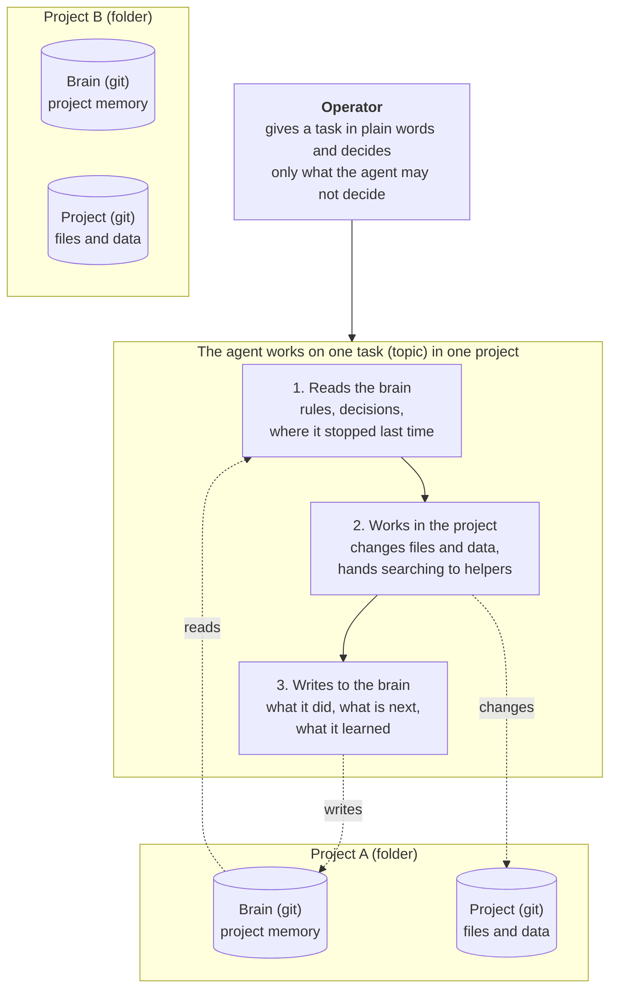
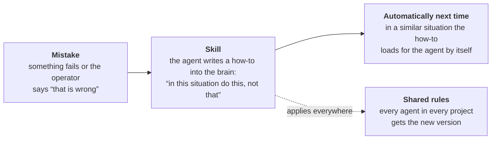

# agent-playbook

Slovak version: [README.md](README.md), the guide in Slovak: [PLAYBOOK.md](PLAYBOOK.md).

A guide to building agents with identity, memory, rules and mail, plus cleaned
sample files from the live private system of one operator. The system has three
parts: the workflow (a plugin with the mechanics), the brain (a git repo with a
persona's data) and a mail service. Work is carried by topics, and agents run in
T3 Code threads. The guide describes what we built, why, and in what order to
build it yourself. It is not a plugin, and nothing gets installed from it.

## How it works (in a nutshell)



- A **folder** is a plain container and remembers nothing. **Git** means files with their full history of changes and a backup. Each project is a folder with two separate repositories side by side: the brain (memory) and the project itself (files and data).
- **Mail:** agents send tasks to each other. **Alarm clock:** wakes an agent when it should continue. **Guards (hooks):** check every reply so the agent does not wait without an alarm and does not ask needless questions.



## Where to start

Read `PLAYBOOK.en.md`. Chapter 0 gives the overview and the glossary, chapter 13
the order of building. Each chapter has a problem, a part "When you need it", the
mechanism, steps without our code, what it requires from the runtime, and a link
to our example in this repo. Copy the mechanisms, not our rules. The rules are
answers to our mistakes, and yours will be different.

## What is here

| path | what it is |
|---|---|
| `PLAYBOOK.md`, `PLAYBOOK.en.md` | the guide itself, in Slovak and in English |
| `README.md`, `README.en.md` | the map of the repo, in Slovak and in English |
| `global/CLAUDE.md` | example of rules that apply to all agents |
| `roles/` | the role index `roles/ROLES.md` and the rules of each role |
| `skills/unslop/SKILL.md`, `skills/chyba/SKILL.md` | skills: writing without marks of machine text, the error loop |
| `rozhodnutia/README.md` | schema of a decision record |
| `lib/public_check.txt` | list of name and address patterns for the public repo check, patterns are in base64 |

## Open repositories

The implementation described in the guide is published in separate repositories
under the MIT license (a `LICENSE` file in each). They are sanitized snapshots of
released versions of private development repositories: names of people, agents,
machines and domains are replaced by placeholders (Alice, Bob, Carol,
`example.com`), and the history of the private repositories is not carried over.
The snapshots are refreshed when a new version is released.

| repo | what it is |
|---|---|
| https://github.com/gavalierm/agentic-flow-open | the workflow: a Claude Code plugin with rules, skills, hooks and brain scripts |
| https://github.com/gavalierm/agentic-comms-open | the mail and wake-up service |
| https://github.com/gavalierm/agentic-brain-template | a brain template (the data of one persona or project) |
| https://github.com/gavalierm/agent-template | an agent template: the repo is its own brain (`"brain": "."`) |

This repo (`agent-playbook`) stays free of code: the guide and the samples.

## What is not in the repo

Code and scripts are in the open repositories above, so they are not here. There is also no brain of a particular operator:
it holds names of people, agents, machines and accounts, addresses, personas,
memory, decision records and logs. Take the mechanisms from the chapters and the
samples of rules and roles from this repo. The code that enforces them you write
yourself, following the chapters and your own runtime.

The samples are cleaned: names are replaced by a role or a placeholder.

## Checks and tests

After cloning, turn on the repo hooks:

```
git config core.hooksPath .githooks
```

The repo carries no code. `pre-commit` and `pre-push` fail when the repo contains
a `.mjs` or `.sh` file, so that a copy of code does not come back. They also run
the public repo check: it goes through all files in git and fails when it finds a
name of a person, agent, machine or account, or an address, from the patterns in
`lib/public_check.txt` (the patterns are in base64 so the list does not give the
names away). A list line starting with `+` is an allowed link. `pre-push` also
checks the author name and the commit messages that go out. The second check goes
through all `*.md` files and fails when a text in backticks mentions a path to a
file that is not in the repo.

The scripts of the checks are in the public repo `https://github.com/gavalierm/agent-runtime`.
The hooks call them from its clone, which they find in the `AGENT_RUNTIME`
variable, otherwise next to this clone in the `agent-runtime` directory. Without
the clone they fail and say what to clone. The checks need Node 22 or newer.

## Language

The source is in Slovak. The English translation is in `PLAYBOOK.en.md` and `README.en.md`. When they differ, the Slovak text wins.

## How to contribute

Send a pull request with a mechanism: how a rule is written, loaded, checked or
fixed. Rules of one operator's operation (who may do what, what is forbidden)
do not belong here, everyone keeps those in their own repo. Before a pull
request, the checks from the part "Checks and tests" pass by themselves through
the hooks.

## License

MIT, file `LICENSE`.
